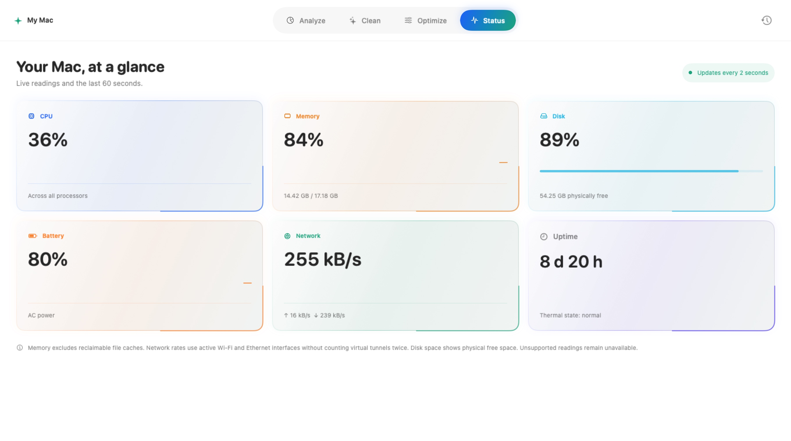
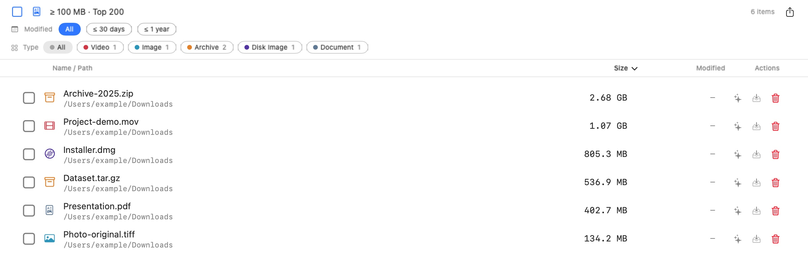

# AmuxAIClean

**Native disk analysis and cleanup for macOS.**

Understand directory usage, review candidates, then decide what to clean.

English · [简体中文](README.md)

[Download Latest](https://github.com/CarGuo/AmuxAICleanRelease/releases/latest) ·
[User Guide](docs/USER_GUIDE.en.md) · [Installation](docs/INSTALL.md) ·
[Releases](https://github.com/CarGuo/AmuxAICleanRelease/releases) · [Documentation](docs/README.md)

Development supported by

<a href="https://amux.ai/">
  <picture>
    <source media="(prefers-color-scheme: dark)" srcset="img/amux-logo-dark.svg" />
    
  </picture>
</a>

Development tokens and the Apple Developer account are sponsored by Amux. This support also gave AmuxAIClean its name.

<!-- v2026.10.14: replace the v1.0–v1.5 introduction and images with the v1.6.12 product structure.
Current production views and isolated examples back these images; see img/screenshots/README.md. -->

## Normal mode: Analyze, Clean, Optimize, Status

New windows open in Normal mode. Its four sections combine space exploration, cleanup review and system information.

| Section | What you can do |
|---|---|
| **Analyze** | Scan a disk or folder, compare usage in a treemap, drill into directories, search and inspect details. |
| **Clean** | Scan system/log files, application caches and explicitly enabled developer caches; review candidates before moving them to Trash. |
| **Optimize** | Inspect supported user-level maintenance tasks and classic launch agents; follow each tool's instructions. |
| **Status** | View CPU, memory, disk, battery, network rates, uptime and thermal status. |

<table>
<tr>
<td width="50%" valign="top"> Clean: scan scope, categories and review.</td>
<td width="50%" valign="top"> Status: system readings in one place.</td>
</tr>
</table>

## Professional mode: files, directories and development tools

Switch modes at the top of the window. The sidebar contains recommended scans, developer artifacts, full-disk scans,
common application caches, custom paths and individual tools.

- **Tree and List**: browse directory sizes and file counts with access/coverage information; use List for batch selection.
- **Large Files**: defaults to files at least 100 MB and a Top 200 view, with size/mtime sorting, type filters and Quick Look. The threshold is configurable.
- **Apps and duplicates**: inspect application usage and associated leftovers; review duplicate groups while retaining a specific copy.
- **Development tools**: inspect artifacts and caches for Xcode, Android, Flutter, Node.js, Rust, Go and Python, with Homebrew, port cleanup and ecosystem workflows.
- **Stash and history**: gather candidates for later review, and attempt to restore matching Trash items from recent cleanup records.

Tree results: compare usage by directory.

Large Files results: locate the largest items.

In the action column, ✨ opens AI assistance, the tray adds an item to Stash, and the Trash icon starts cleanup review.
The column-header question mark explains these actions with an example. The top-right question mark reopens the control guide.

> Images were updated on October 14, 2026 using offscreen renders of the production views corresponding to v1.6.12.
> Files and candidate sizes are isolated examples; Status uses read-only readings from the capture machine.
> These workspace/tool images are not real user scans, performance benchmarks or runtime acceptance evidence.
> [Image provenance and reproduction](img/screenshots/README.md).

## Confirmation and recovery

Measured disk usage is not the amount available for cleanup. Restricted, incomplete and unknown scopes retain their notices.

Normal mode uses detailed review. Professional mode uses a compact confirmation for ordinary items and strict confirmation
for eligible overrides, requiring `DELETE`. Protected boundaries, paths outside the allowed scope and actual OS permissions
cannot be removed by strict confirmation. Complete success uses a brief notice; failures, partial success and unsubmitted
requests use an explanatory dialog.

File cleanup uses system Trash. History can attempt restoration only while the matching Trash object still exists and its
identity is verifiable. Emptying Trash removes this recovery window. Simulator Device/Runtime operations in the Apple workflow
are explicitly identified managed uninstalls and cannot be restored from Trash. See the [User Guide](docs/USER_GUIDE.en.md).

## Installation and updates

The official DMG supports **macOS 13.5+, Apple Silicon and Intel**, with **Simplified Chinese / English** and light/dark appearance.

1. Download the DMG and matching SHA256 file from the [official latest release](https://github.com/CarGuo/AmuxAICleanRelease/releases/latest).
2. Verify the file, open the DMG, drag AmuxAIClean into Applications and launch it.
3. Grant Full Disk Access if needed. Restricted scopes retain incomplete notices; after an upgrade or permission change,
   restart as instructed by macOS and rescan.

The supported upgrade floor is **1.6.2**. Older configuration, service identities and Undo history from 1.5.9, 1.6.0 and 1.6.1
are not automatically migrated. In-app update checks use the public distribution repository,
[CarGuo/AmuxAICleanRelease](https://github.com/CarGuo/AmuxAICleanRelease).
This repository hosts the introduction, guides, screenshots and release assets. Source and maintainer development documentation are managed separately.

[Installation details](docs/INSTALL.md) · [Maintainer publishing guide](docs/PUBLISHING.md)

## Privacy and quality

Local safety decisions do not depend on AI. AI is off by default and sends context only after configuration and an explicit
request. Launch update checks are enabled on first install and can be disabled. See the [Privacy Policy](PRIVACY.md) for network
shares, cloud placeholders and Quick Look. Optional Sentinel is off by default and runs a local, non-privileged agent for the signed-in user.

Nine Swift packages cover scanning, safety, authorization, history storage and supporting functionality. Package tests,
builds, runtime interaction and installer checks are recorded separately; rendered images do not establish functional acceptance.
See [Current Product State](docs/CURRENT_STATE.md), [confirmation and recovery](docs/USER_GUIDE.en.md#4-confirmation-failures-and-recovery) and [Security](SECURITY.md).

## Documentation and feedback

[User Guide](docs/USER_GUIDE.en.md) · [Installation](docs/INSTALL.md) ·
[Publishing and verification](docs/PUBLISHING.md) · [Documentation](docs/README.md) ·
[Report an issue](https://github.com/CarGuo/AmuxAICleanRelease/issues)

Include App/macOS versions, mode, entry point and reproduction steps. Remove private paths from screenshots or logs first.

## License

[MIT](LICENSE) · Copyright © 2026 CarGuo
