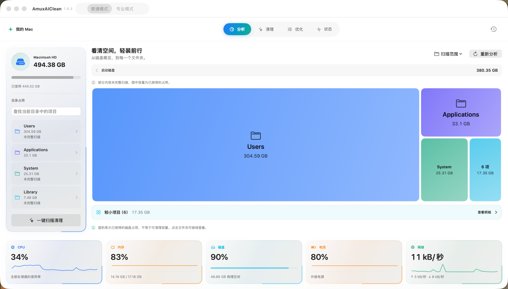
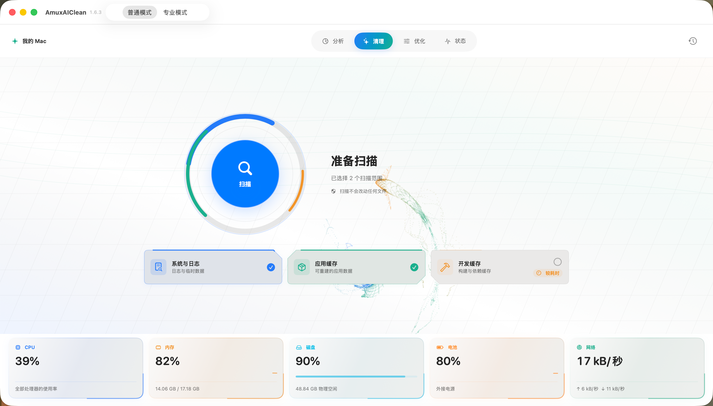
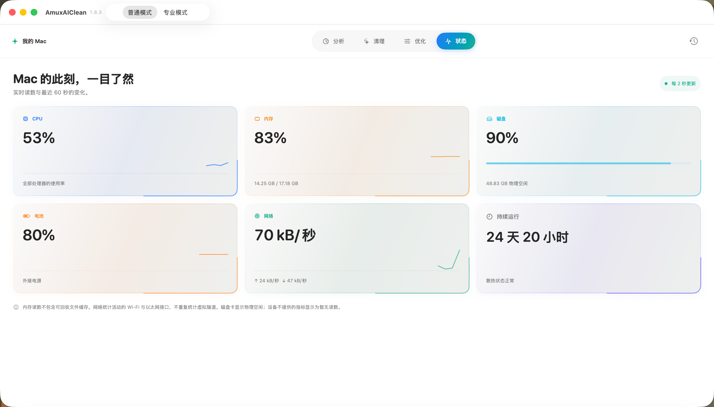
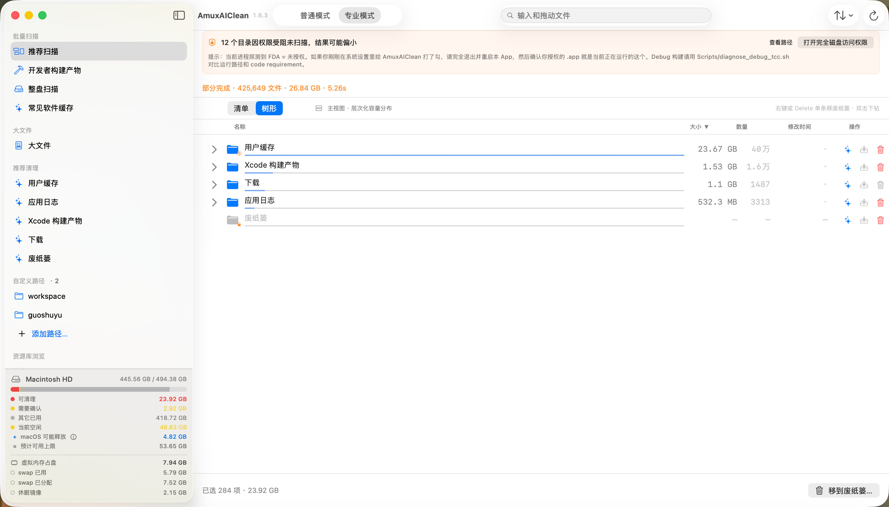

<div align="center">


# AmuxAIClean

### 看清空间，轻装前行。

原生 macOS 空间分析与清理工具。<br/>
从磁盘占用到每个目录，从扫描结果到清理确认，让整理 Mac 更直观。

<p>
  <a href="https://github.com/CarGuo/AmuxAICleanRelease/releases/latest"></a>
</p>

<p>
  
  
  
</p>

[下载最新版](https://github.com/CarGuo/AmuxAICleanRelease/releases/latest) · [功能介绍](#功能介绍) · [安装说明](#安装说明) · [版本记录](https://github.com/CarGuo/AmuxAICleanRelease/releases) · [反馈问题](https://github.com/CarGuo/AmuxAICleanRelease/issues)

</div>

<br/>

<div align="center">
  
  <p><sub>普通模式 · 空间分析，从磁盘概览到每一个文件夹。</sub></p>
</div>

## 功能介绍

### 从空间占用，找到整理方向

用矩形面积比较目录占用，点击文件夹逐层查看。名称搜索、目录列表与分页帮助你定位内容；较小项目会合并为可读区域，打开明细后仍可查看全部成员。

普通模式提供四个栏目，将常用操作放在一起：

| 栏目 | 可以做什么 |
| :--- | :--- |
| **分析** | 选择扫描范围，查看磁盘占用图、目录明细与大体积内容。 |
| **清理** | 一键发起扫描，检查系统与日志、应用缓存及可选的开发缓存，审阅后确认处理。 |
| **优化** | 查看用户空间维护任务与传统启动代理，按需要执行。 |
| **状态** | 集中查看 CPU、内存、磁盘、电池、网络速率，以及运行时间和散热状态。 |

<table>
  <tr>
    <td width="50%" valign="top">
      <h3>扫描清理</h3>
      <p>按需要选择扫描范围，先看清候选，再决定整理哪些内容。</p>
      <a href="img/screenshot-clean.png"></a>
    </td>
    <td width="50%" valign="top">
      <h3>实时状态</h3>
      <p>系统读数与近期变化集中呈现，随时了解 Mac 的运行状态。</p>
      <a href="img/screenshot-status.png"></a>
    </td>
  </tr>
</table>

### 专业模式，提供更细的控制

- **大文件与重复文件**：定位占用较大的文件，检查重复内容，辅助整理长期积累的数据。
- **开发者空间管理**：检查 Xcode、Android、Flutter、Node.js 等开发环境的构建产物、依赖缓存及旧版本资源。
- **应用与残留管理**：检查已安装应用及关联残留，按安全规则审阅处理。应用卸载位于专业模式。
- **开发者工具与工作流**：提供更细的扫描分类、文件列表、Homebrew 与开发环境管理入口。
- **可选 AI 辅助**：辅助理解扫描结果和清理建议，默认关闭，需要自行配置服务并主动使用。

普通模式和专业模式分别在首次进入时展示逐控件引导。专业侧栏按功能块介绍；尚未扫描时也会介绍 AI、加入待处理和删除三个条目按钮。可随时通过窗口中的指南按钮或 Help 菜单重放。

<div align="center">
  
  <p><sub>专业模式 · 分类扫描与树形明细，权限受限会明确标记。</sub></p>
</div>

### 先审阅，再清理

扫描结果表示已测得的占用，不等于全部可清理容量。权限受限或未完成测量的内容会明确标识。

文件清理先展示候选与确认信息，再通过废纸篓处理；关键路径与敏感数据受安全规则保护。最近清理记录可用于尝试恢复，前提是废纸篓中的项目仍存在且身份未变化。

## 安装说明

支持 **macOS 13.5 及以上**，同一份安装包适用于 **Apple Silicon 与 Intel**。提供 **简体中文 / English**，支持浅色与深色外观。

1. 从 [Releases](https://github.com/CarGuo/AmuxAICleanRelease/releases/latest) 下载 DMG。
2. 打开 DMG，将 **AmuxAIClean** 拖入 **Applications**。
3. 从 Applications 启动应用，选择需要扫描的范围。
4. 如需访问受保护目录，可在“系统设置 → 隐私与安全 → 完全磁盘访问”中为 AmuxAIClean 授权。无法访问的内容会保留不完整提示。

<details>
<summary><strong>版本、签名与文件校验</strong></summary>

| 项目 | 当前版本 |
| :--- | :--- |
| 版本 | 1.6.9（229） |
| 架构 | Apple Silicon / Intel 通用二进制 |
| 签名 | Developer ID Application: SentenceEnd Inc |
| 公证 | Apple Notary Accepted，已附加票据并通过 Gatekeeper 校验 |

[下载 1.6.9 DMG](https://github.com/CarGuo/AmuxAICleanRelease/releases/download/v1.6.9/AmuxAIClean-1.6.9.dmg) · [下载 SHA256 校验文件](https://github.com/CarGuo/AmuxAICleanRelease/releases/download/v1.6.9/AmuxAIClean-1.6.9.dmg.sha256)

同时下载 DMG 和校验文件后，在下载目录运行：

```bash
shasum -a 256 -c AmuxAIClean-1.6.9.dmg.sha256
```

输出 `AmuxAIClean-1.6.9.dmg: OK` 表示文件与发布时的校验值一致。

</details>

<details>
<summary><strong>联网与版本更新说明</strong></summary>

本地扫描与安全判定不依赖 AI。启用 AI 后，主动发送的上下文由你配置的服务处理。应用会检查 GitHub 版本更新；访问网络卷、云端占位文件或使用系统预览时，macOS 与存储提供方可能产生网络读取。

请以本仓库的 [Releases 页面](https://github.com/CarGuo/AmuxAICleanRelease/releases) 为安装包发布入口。当前安装包的应用内更新检查尚未迁移到本仓库，获取后续版本请查看此页面。

</details>

<br/>

---

<div align="center">

**AmuxAIClean · 让空间整理更清楚**

[下载应用](https://github.com/CarGuo/AmuxAICleanRelease/releases/latest) · [查看版本记录](https://github.com/CarGuo/AmuxAICleanRelease/releases) · [反馈问题](https://github.com/CarGuo/AmuxAICleanRelease/issues)

<sub>本仓库提供产品介绍、截图与发行包。反馈问题时，请附上应用版本、macOS 版本和复现步骤，并移除截图或日志中的私人路径与敏感信息。</sub>

</div>

<!-- v1.6.3: Existing logo and four user-provided screenshots are kept in img for reproducible README rendering. Distribution binaries remain Release assets. -->

<!-- v1.6.9: Independently acknowledge Normal and Professional first visits; update the notarized 229 download while preserving the in-app update source disclosure. -->
