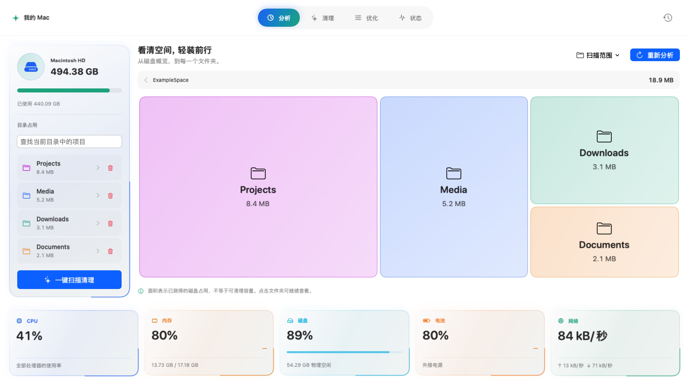
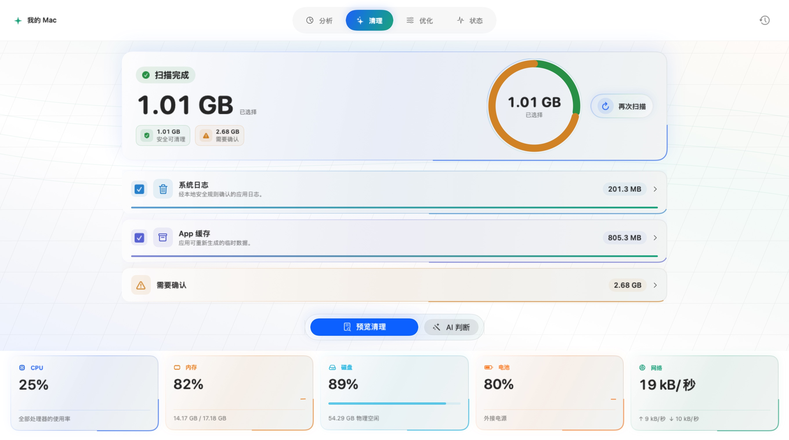
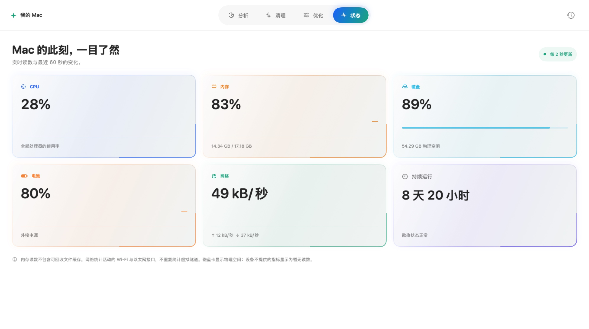
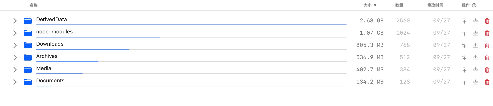
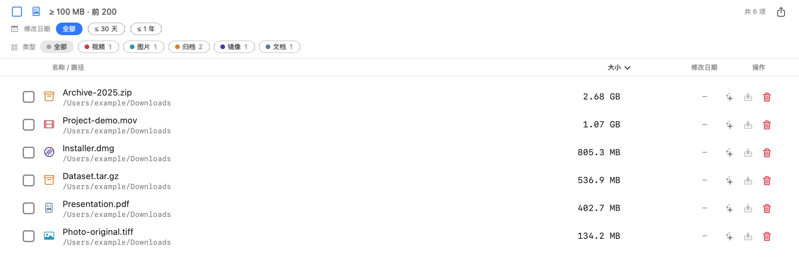
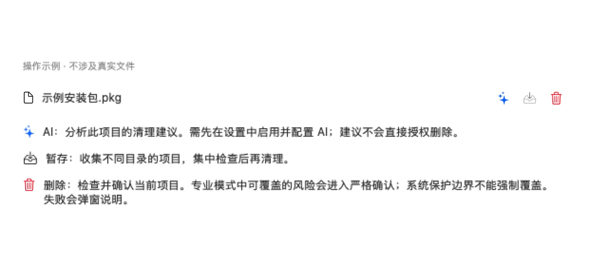

# AmuxAIClean

**原生 macOS 空间分析与清理工具。**

看清目录占用，审阅清理候选，再决定如何整理。

[English](README.en.md) · 简体中文

   

[下载最新版](https://github.com/CarGuo/AmuxAICleanRelease/releases/latest) · [使用指南](docs/USER_GUIDE.md) · [安装说明](docs/INSTALL.md) · [版本记录](https://github.com/CarGuo/AmuxAICleanRelease/releases) · [文档目录](docs/README.md)

## 赞助商

<!-- v2026.10.14：按用户要求使用显著的赞助卡，Logo 与正文介绍并列展示。 -->
<table>
<tr>
<td width="280" align="center" valign="middle">
<a href="https://amux.ai/">
<picture>
<source media="(prefers-color-scheme: dark)" srcset="img/amux-logo-dark.svg" />

</picture>
</a>
</td>
<td valign="middle">
<h3>Amux · 多模型 API 平台</h3>

Amux 为开发者和 AI 应用提供统一的模型 API 接入，可比较模型与供应商，并按需要选择按量或订阅计费。平台提供自动供应商故障切换，帮助接入多种主流模型。

感谢 Amux 为本项目提供<strong>开发 Token 与 Apple 开发者账号</strong>，支持 AmuxAIClean 的开发、测试和公证分发。项目名称 <strong>AmuxAIClean</strong> 也源于这份赞助。

<a href="https://amux.ai/">访问 Amux，了解模型与 API 服务 →</a>

</td>
</tr>
</table>

<!-- v2026.10.14：旧首页和截图停留在 v1.0–v1.5；按 v1.6.12 产品结构更新。
截图复用当前生产视图与隔离示例，来源见 img/screenshots/README.md。 -->

## 普通模式：分析、清理、优化、状态

新窗口默认进入普通模式。四个栏目把空间定位、候选审阅和系统信息放在同一个工作台。

| 栏目 | 使用方式 |
|---|---|
| **分析** | 选择磁盘或文件夹，扫描后用矩形空间图比较占用，逐层进入目录，搜索和查看明细。 |
| **清理** | 扫描系统与日志、应用缓存，以及主动选入的开发缓存；先审阅候选，再确认移到废纸篓。 |
| **优化** | 查看支持的用户态维护任务与传统启动代理；每个工具按其说明操作。 |
| **状态** | 查看 CPU、内存、磁盘、电池、网络速率、运行时间与散热状态。 |

<table>
<tr>
<td width="50%" valign="top"> 清理：扫描范围、分类结果与审阅入口。</td>
<td width="50%" valign="top"> 状态：集中查看系统读数。</td>
</tr>
</table>

## 专业模式：目录、文件与开发环境

窗口顶部可切换专业模式。侧栏提供推荐扫描、开发者构建产物、整盘扫描、常见软件缓存、
自定义路径和工具入口。

- **树形与清单**：逐层浏览容量和文件数，查看权限与扫描完整性；清单支持批量选择。
- **大文件**：默认筛选至少 100 MB 的文件并展示 Top 200，支持大小、修改时间排序、类型筛选和 Quick Look；阈值可在设置中调整。
- **应用与重复文件**：查看应用占用、卸载关联残留；重复文件按内容分组，选定保留副本后审阅其它副本。
- **开发者工具**：查找 Xcode、Android、Flutter、Node.js、Rust、Go、Python 等环境的构建产物与缓存，另有 Homebrew、端口清理和按生态组织的工作流。
- **稍后处理与最近清理**：把候选加入待处理集合，统一审阅；从最近清理记录尝试恢复匹配的废纸篓项目。

树形结果区：按目录比较占用。

大文件结果区：定位体积较大的文件。

**操作列**中的 ✨ 是 AI 辅助，托盘图标是“稍后处理”，废纸篓图标是回收入口。
点击操作列表头的问号可查看当前界面提供的示例说明；窗口右上角问号可重新打开控件引导。

> 图片更新于 2026-10-14，来自 v1.6.12 对应生产视图的离屏渲染。文件、候选容量为隔离示例；
> 状态页为采集时本机只读读数。图片展示工作台或工具内页，不代表真实用户扫描结果、性能基准或运行交互验收。
> [素材来源与复现方式](img/screenshots/README.md)。

## 确认与恢复

扫描得到的占用不等于可清理容量。受限、未完成或未知的范围会保留提示。

普通模式提供详细审阅；专业模式对普通项目使用简洁确认，对允许覆盖的风险直接进入严格确认，
需要输入 `DELETE`。系统保护边界、越界路径及实际系统权限不能通过严格确认解除。
完整成功使用短暂提示，失败、部分成功和未提交请求使用弹窗说明原因。

文件清理通过系统废纸篓完成。最近清理记录仅在对应废纸篓对象仍存在且身份可验证时提供恢复；
清空废纸篓后不保证恢复。Apple 工作流中的 Simulator Device / Runtime 属于明确标识的系统托管卸载，
不能从废纸篓恢复。操作细节见 [使用指南](docs/USER_GUIDE.md)。

## 安装与更新

正式 DMG 支持 **macOS 13.5+、Apple Silicon / Intel**，提供 **简体中文 / English** 与浅色、深色外观。

1. 从 [官方最新 Release](https://github.com/CarGuo/AmuxAICleanRelease/releases/latest) 下载 DMG 和同版本 SHA256 文件。
2. 校验后打开 DMG，把 AmuxAIClean 拖入 Applications，再启动应用。
3. 按需要授予完全磁盘访问；受限范围仍会显示不完整提示。升级或重新授权后按系统提示重启并重新扫描。

当前升级兼容下限为 **1.6.2**，不自动迁移 1.5.9、1.6.0、1.6.1 的旧配置、服务身份或撤销历史。
应用内更新检查指向公开发行仓库 [CarGuo/AmuxAICleanRelease](https://github.com/CarGuo/AmuxAICleanRelease)。
本仓库提供产品介绍、使用指南、截图与发行附件；源码和维护者开发文档单独管理。

[完整安装指南](docs/INSTALL.md) · [维护者发布流程](docs/PUBLISHING.md)

## 隐私与质量

本地安全判定不依赖 AI。AI 默认关闭，自行配置服务并主动请求后才发送上下文；
更新检查首次安装默认开启，可在设置中关闭。网络卷、云端占位文件和 Quick Look 的系统读取边界见
[隐私政策](PRIVACY.md)。可选 Sentinel 默认关闭，启用后运行当前用户的非特权本地 Agent。

九个 Swift 包覆盖扫描、安全、删除授权、历史存储及支撑能力。包测试、构建、真实交互和最终安装包
验证分别记录，不把离屏图片当成功能验收。当前范围见 [产品状态](docs/CURRENT_STATE.md)，
确认与恢复见 [使用指南](docs/USER_GUIDE.md#4-删除确认失败与恢复)，安全边界见 [SECURITY.md](SECURITY.md)。

## 文档与反馈

[使用指南](docs/USER_GUIDE.md) · [安装与权限](docs/INSTALL.md) ·
[公开发布与校验](docs/PUBLISHING.md) · [文档目录](docs/README.md) ·
[反馈问题](https://github.com/CarGuo/AmuxAICleanRelease/issues)

反馈时附应用与 macOS 版本、使用模式、入口和复现步骤；先移除图片或日志中的私人路径。

## License

[MIT](LICENSE) · Copyright © 2026 CarGuo
