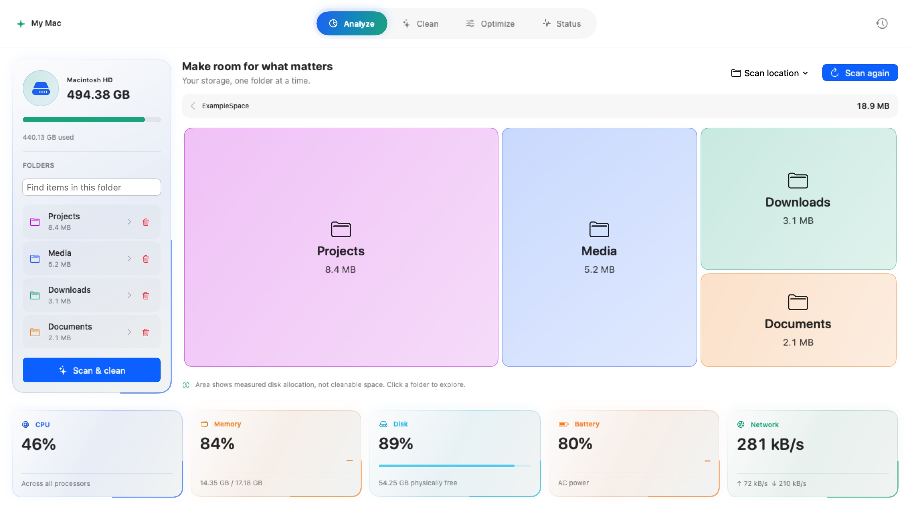
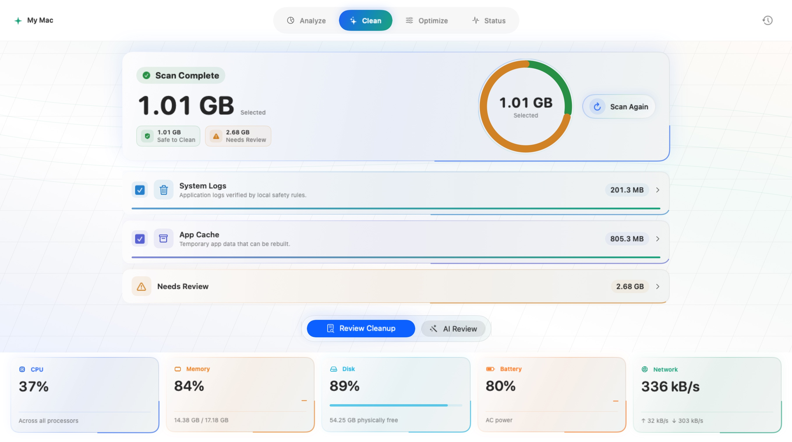
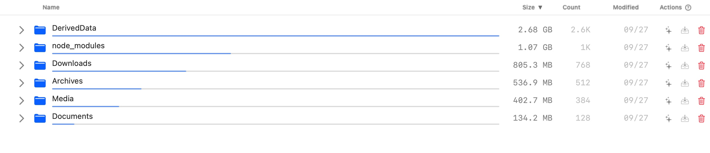
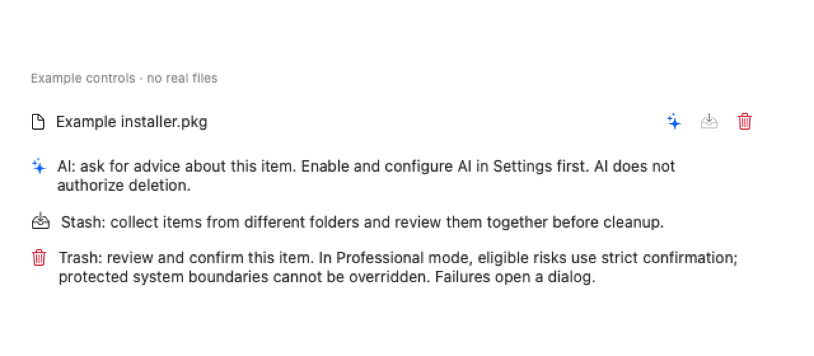

# AmuxAIClean User Guide

[简体中文](USER_GUIDE.md) · [Installation and permissions](INSTALL.md) · [Download Latest](https://github.com/CarGuo/AmuxAICleanRelease/releases/latest)

<!-- v2026.10.14: document v1.6.12's workspace, Professional tools and unified confirmation flow. -->

This guide describes **v1.6.12**. Images use current production views and isolated example data;
[image provenance](../img/screenshots/README.md) records how they were captured.

## 1. Find disk usage before choosing cleanup scope

New windows open in Normal mode's Analyze section. Select a disk or folder from the scope control and scan it.

- Treemap area represents measured disk usage. Open a folder to drill down.
- The directory list and search help locate items; use breadcrumbs to go back.
- Smaller items are grouped for readability, with their members available in details.
- Physical usage, logical size, file count and cleanup suggestions are different measures. Treemap area is not cleanable capacity.

Permissions, scan budgets, volume boundaries and product protection can leave coverage incomplete. Inspect the affected
scope and reason. Full Disk Access improves visibility in some protected directories; it does not remove sensitive-data protections.

## 2. The four Normal workspace sections

| Section | Task | How to use it |
|---|---|---|
| Analyze | Explore disk or folder usage | Choose scope, scan, drill down and search. |
| Clean | Review common cleanup candidates | Choose scan stages, wait for results and preview cleanup before confirmation. Developer caches are opt-in. |
| Optimize | User-level maintenance and startup inspection | Read each tool's instructions. Classic launch-agent inspection is read-only; modern login items are managed in System Settings. |
| Status | Observe system operation | Inspect CPU, memory, disk, battery, network, uptime and thermal readings. |

Green suggestions identify safe candidates under the available evidence. Review items that require confirmation.
Scanning does not delete files. Preview Cleanup opens review; the final affirmative action submits the recycling request.

## 3. Professional mode and row actions

Switch at the top of the window. The sidebar contains batch scans, recommended categories, custom paths, Library browsing,
Large Files, application tools and developer workflows. The path field and folder drag-and-drop can initiate a scoped analysis.

Tree supports directory exploration; List supports filtering and batch selection. Large Files defaults to at least 100 MB and
Top 200, with a configurable threshold, size/mtime sorting, type filters and Quick Look.

| Control | Meaning |
|---|---|
| ✨ | AI assistance, after explicit configuration and enablement. Advice does not authorize deletion. |
| Tray | Add a candidate to Stash for later review. |
| Trash | Validate the item and enter its confirmation flow. |
| Action-column question mark | Show an example that does not operate on real files. |
| Top-right question mark | Reopen the current mode's control guide. |

An unavailable action may mean unfinished measurement, protection, failed eligibility or another active operation.
Inspect its explanation; missing Full Disk Access is not the only possible cause.

## 4. Confirmation, failures and recovery

**Normal mode** presents detailed review. **Professional mode** uses compact confirmation for ordinary candidates;
eligible risks enter strict confirmation directly and require `DELETE`. This covers specific vendor-path or incomplete-scan
risks and requires another validation before execution.

Strict confirmation cannot override system protection, HOME/Library root protection, traversal, paths outside the allowed scope
or actual OS permissions. It also cannot replace valid cleanup-history storage: if records cannot be saved, the request is not
submitted and the files remain in place.

- **Complete success** uses a brief notice.
- **Failure, partial success or an unsubmitted request** opens a dialog explaining the cause. Only confirmed recycled items enter history.
- **Pending verification** means the system outcome is unknown; inspect the notice and wait for reconciliation instead of resubmitting the request.

File cleanup uses system Trash. Recent cleanup history can attempt restoration only while the matching object remains there
and its identity is verifiable. Emptying Trash or externally moving/replacing objects removes that guarantee. A history record
of an accepted operation is not a claim that every requested item succeeded.

**Simulator Device/Runtime** entries in the Apple workflow are clearly labelled managed uninstalls. They cannot be restored
from Trash or cleanup history. Other file candidates still use Trash.

## 5. Common Professional tools

| Tool | Task and boundary |
|---|---|
| Large Files | Locate large files; inspect their content and purpose before cleanup. Size is not a safety verdict. |
| Duplicates | Hash candidate content locally. Retain a specific copy, review the others, then revalidate identity/content before recycling. |
| App usage / Uninstall | Inspect associated data using application identity and file evidence; not every possible leftover is guaranteed to be found. |
| Developer artifacts / Workflows | Inspect build output, dependency caches and versioned resources by ecosystem. Regeneration or downloading again costs time. |
| Homebrew | Check package details and dependencies; package commands and file recycling follow their tool-specific confirmation. |
| Port cleanup | Inspect listening processes before confirming an action; stopping a process may interrupt work. |
| Stash | Temporarily collect candidates. Adding an item does not delete it. |

## 6. Settings, upgrades and feedback

- Simplified Chinese and English are supported, with light/dark appearance.
- AI is off by default. Explicit requests after enablement send context to the configured service; see the [Privacy Policy](../PRIVACY.md) for fields and redaction.
- Updates come from [CarGuo/AmuxAICleanRelease](https://github.com/CarGuo/AmuxAICleanRelease/releases). Launch checks can be disabled in Settings.
- Sentinel is off by default. Read its settings before enabling it; disable it and confirm it is unregistered before uninstalling the App.
- Upgrades are supported from **1.6.2 onward**. Older configuration, service identities and Undo history from 1.5.9, 1.6.0 and 1.6.1 are not automatically migrated.

For feedback, include the App version, macOS version, mode, entry point, steps and displayed notice. Remove private paths and usernames first.
[Report an issue](https://github.com/CarGuo/AmuxAICleanRelease/issues) · [Implementation and validation scope](CURRENT_STATE.md)
